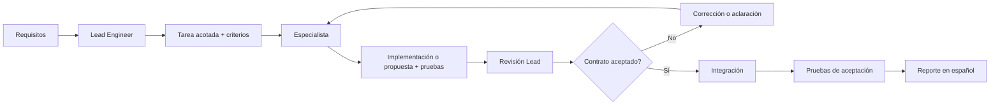

# Arquitectura del workflow multiagente

Estos agentes son roles de desarrollo coordinados por una sesión Lead (Codex u opencode); no son servicios productivos independientes.

## Roles

- **Lead Engineer:** define alcance, acepta contratos, asigna archivos, reconcilia propuestas, integra y publica el reporte.
- **ETL Engineer:** fuente, extracción, snapshots raw, normalización, validación, deduplicación y métricas.
- **Database Engineer:** esquema, PostGIS, migraciones, constraints, índices, upserts y SQL analítico.
- **QA/Data Quality Engineer:** criterios, casos límite, regresiones, consistencia y evidencia de pruebas.

## Flujo

## Paralelismo seguro

Pueden correr en paralelo revisiones read-only del contrato de fuente por ETL, DB y QA. No pueden correr en paralelo dos ediciones del mismo contrato, migración o archivo. La implementación de DB depende del contrato aceptado; API depende del esquema consumer-facing; frontend depende del contrato API.

## Interfaces y conflictos

Las interfaces se acuerdan primero en documentos versionados. Si una recomendación contradice otra, el Lead compara evidencia, impacto y criterios; no resuelve el conflicto ocultándolo en código. La decisión final se registra en un ADR o en la especificación del proyecto.

## Fallos

Un fallo de herramienta, red o dependencia se reporta como limitación reproducible. Un fallo de datos debe conservar rechazados y razones. Un test no ejecutado no se presenta como exitoso. El Lead puede reintentar una tarea, dividirla o detenerla, pero no relajar silenciosamente la aceptación.

## Capacidad real de Codex verificada

El CLI local `0.162.1` soporta perfiles TOML (`--profile`), worktrees (`--worktree`), sandbox read-only/workspace-write, sesiones y el feature estable `multi_agent`. La delegación dentro de esta sesión se realiza con las herramientas de subagentes del harness; el CLI local no expone un comando de “crear agente especialista” en `codex agents`. Por ello las instrucciones de rol viven en Markdown versionado y los TOML solo fijan configuración operacional.

## Equivalencia con opencode

Los mismos roles están traducidos al formato nativo de opencode en `.opencode/agents/` (`etl-engineer.md`, `database-engineer.md`, `qa-data-quality-engineer.md`). El contenido de rol es equivalente al de `docs/agent-workflows/agents/`; esos archivos siguen siendo la referencia para Codex.

El rol Lead Engineer no tiene perfil propio en Codex (es la sesión principal) y tampoco lo tiene en opencode: lo ejerce la sesión primaria (`build`) guiada por `AGENTS.md` y este documento.

Mapeo de perfiles TOML de Codex a frontmatter de opencode:

| Perfil Codex | `model_reasoning_effort` | `approval_policy` | `sandbox_mode` | Equivalente opencode |
|---|---|---|---|---|
| `zmg-etl` | `medium` | `on-request` | `workspace-write` | `reasoningEffort: medium`, `permission.edit: allow`, `permission.bash: ask` |
| `zmg-db` | `medium` | `on-request` | `workspace-write` | `reasoningEffort: medium`, `permission.edit: allow`, `permission.bash: ask` |
| `zmg-qa` | `low` | `on-request` | `read-only` | `reasoningEffort: low`, `permission.edit: deny`, `permission.bash: ask` |

Notas del mapeo:

- `reasoningEffort` es un option de paso (`passthrough`) específico del proveedor/modelo; se ignora si el modelo no lo soporta. Quitar la línea del frontmatter si provoca errores en el proveedor.
- `approval_policy = "on-request"` se traduce a `bash: ask`: cada comando requiere confirmación del usuario.
- opencode no tiene sandbox de filesystem para `bash`. El modo `read-only` de QA se garantiza con `edit: deny` (bloquea `write`, `edit` y `apply_patch`) más la aprobación manual de comandos; un comando `bash` aprobado podría escribir fuera de las herramientas de edición. Es la única divergencia conocida frente al sandbox de Codex.
- `mode: all` permite usar cada especialista como agente primario (Tab / `opencode run --agent`) y como subagente (`@mención` o herramienta Task).
