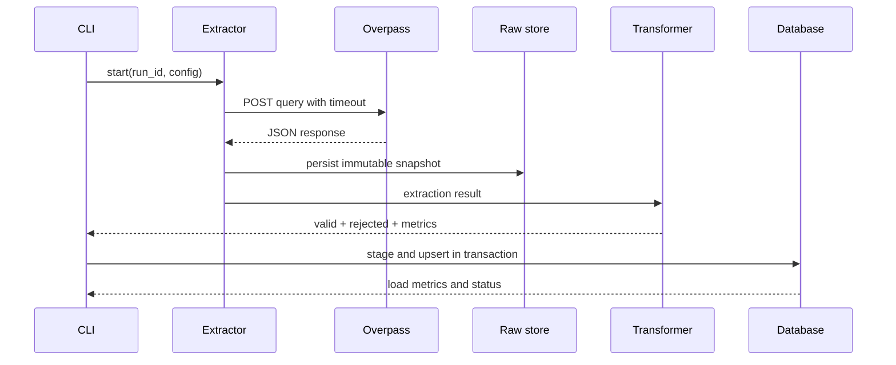

# Flujo de datos

## Estado del flujo

1. Construir una consulta Overpass desde `config/sources.yaml`. **Implementado.**
2. Obtener un JSON con elementos `node`, `way` y `relation` cuando aplique. **Implementado** para modos offline y live.
3. Guardar el payload original junto con `run_id`, consulta/hash, timestamps y fuente. **Implementado.**
4. Convertir cada elemento a un registro normalizado. **Implementado** en `transform_payload`.
5. Separar registros válidos y rechazados con razones explícitas. **Implementado** en `TransformationResult`; la persistencia queda pendiente.
6. Cargar staging y después analytics dentro de límites transaccionales documentados. **Implementado** en `load_run`; una ejecución se persiste en una sola transacción.
7. Servir solo la capa consumer-facing a la API. **Implementado** en `api/`, que consulta únicamente `analytics.cafes`.

## Identidad y tiempo

`source + object_type + object_id` identifica una observación de fuente. `retrieved_at` indica cuándo se obtuvo; no se interpreta como fecha de modificación de OpenStreetMap. Una ausencia posterior no será una baja confirmada.

## Secuencia futura

