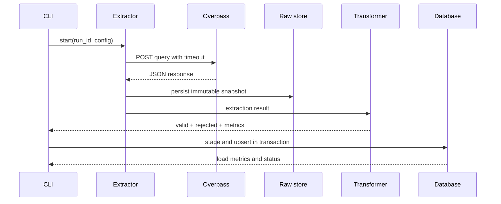

# Flujo de datos

## Flujo planeado

1. Construir una consulta Overpass desde `config/sources.yaml`.
2. Obtener un JSON con elementos `node`, `way` y `relation` cuando aplique.
3. Guardar el payload original junto con `run_id`, consulta/hash, timestamps y fuente.
4. Convertir cada elemento a un registro normalizado.
5. Separar registros válidos y rechazados con razones explícitas.
6. Cargar staging y después analytics dentro de límites transaccionales documentados.
7. Servir solo la capa consumer-facing a la API.

## Identidad y tiempo

`source + object_type + object_id` identifica una observación de fuente. `retrieved_at` indica cuándo se obtuvo; no se interpreta como fecha de modificación de OpenStreetMap. Una ausencia posterior no será una baja confirmada.

## Secuencia futura

